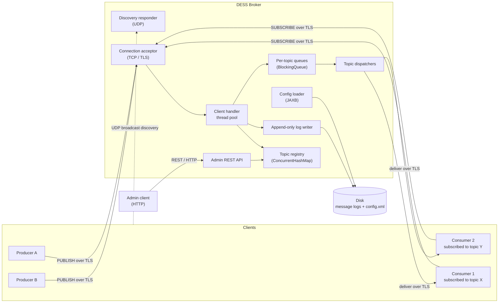
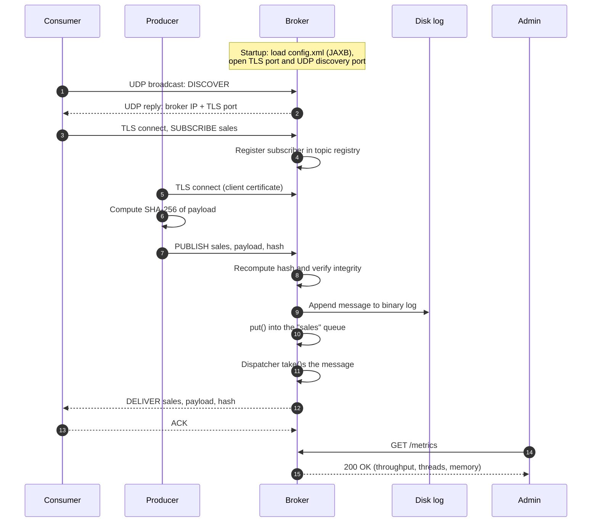

# DESS — Distributed Event Streaming System

[](https://github.com/Dieg0R01/DESS/actions/workflows/ci.yml)

> A publish/subscribe message broker written from scratch in plain Java, built as the practical project for a **Distributed Systems** course in Computer Engineering.

DESS is a small event streaming platform inspired by the architecture of systems like Apache Kafka and RabbitMQ. Producers publish events to named **topics**, a central **broker** buffers, persists and routes those events, and consumers subscribed to a topic receive them in real time. An HTTP **admin API** allows the broker to be inspected and managed from the outside.

The goal is not to compete with production brokers, but to implement by hand — on top of the JDK — the building blocks that a distributed system relies on: networking over TCP and UDP, multithreading and synchronization, durable storage, XML configuration, TLS encryption, message integrity and a web management interface.

> **Status:** protocol version 2 is implemented: a plain-TCP broker with `produce` and `consume`. Messages stay in memory for the life of the process. The durable log, TLS, UDP discovery, XML configuration and the admin API remain the target architecture.

---

## Table of contents

- [Goals and non-goals](#goals-and-non-goals)
- [Architecture](#architecture)
- [Message lifecycle](#message-lifecycle)
- [Wire protocol](#wire-protocol)
- [Module map](#module-map)
- [Technology stack](#technology-stack)
- [Configuration](#configuration)
- [Admin API](#admin-api)
- [Getting started](#getting-started)

---

## Goals and non-goals

### Goals

- **Reliable, ordered delivery** between producers and consumers over persistent TCP connections.
- **Concurrent broker engine** able to serve many clients at once without one slow client blocking the rest.
- **Decoupled ingestion and delivery** through per-topic in-memory queues (producer–consumer pattern).
- **Durability:** messages survive a broker restart thanks to an append-only log on disk.
- **Zero-configuration discovery:** clients find the broker on the local network via UDP broadcast.
- **Security:** TLS-encrypted channels, certificate-based authentication of producers and SHA-256 integrity checks on every message.
- **Observability and control:** a REST API to list, create and delete topics and to read runtime metrics.

### Non-goals (for now)

- Multi-broker clustering, replication or leader election.
- Topic partitioning and consumer groups.
- Exactly-once delivery semantics.
- Compatibility with the Kafka, AMQP or MQTT wire protocols.

These may be revisited once the core system is complete.

---

## Architecture

The system is made of three kinds of independent processes that communicate over the network, plus an administrative client.



### Components

| Component | Responsibility |
|-----------|----------------|
| **Producer** | Generates events (audit logs, metrics, transactions…) and publishes them to a topic. |
| **Consumer** | Subscribes to one or more topics and processes incoming messages as they arrive. |
| **Broker** | Accepts connections, validates and persists messages, buffers them per topic and fans them out to subscribers. |
| **Admin client** | Uses the broker's REST API to inspect state, manage topics and read metrics. |

### Broker internals

- **Connection acceptor.** A `ServerSocket` (later `SSLServerSocket`) runs `accept()` in a loop and hands every new socket to an `ExecutorService`, so serving one client never blocks the others. `setSoTimeout()` is used to detect clients that disappear silently.
- **Topic registry.** A `ConcurrentHashMap<String, Topic>` holds the topic catalogue and each topic's set of active subscribers, allowing safe concurrent reads and writes.
- **Per-topic queues.** Each topic owns a bounded `BlockingQueue`. Client handler threads `put()` incoming messages; a dedicated dispatcher thread per topic `take()`s them and delivers them to every subscriber, blocking naturally when the queue is empty.
- **Flow control.** A `Semaphore` caps the number of in-flight, not-yet-delivered messages held in memory, applying back-pressure to producers when the broker is saturated.
- **Delivery acknowledgements.** When a message requires confirmation from *N* consumers, the broker waits on a `CountDownLatch(N)` until all ACKs arrive (or a timeout expires).
- **Persistence.** Every accepted message is appended to a binary log through `DataOutputStream` over a `BufferedOutputStream`, so it can be replayed after a restart.
- **Discovery responder.** A `DatagramSocket` listens on a well-known UDP port. Clients broadcast a discovery request and the broker replies with its IP address and TCP port, resolved through `NetworkInterface` / `InetAddress`.
- **Admin API.** A lightweight embedded HTTP server exposes resource-oriented endpoints for management and monitoring.

---

## Message lifecycle

The end-to-end journey of a single message through the complete system:



---

## Wire protocol

Protocol version 2 is a binary framing on plain TCP. Integers are big-endian and there is no padding. One frame is one record:

```text
uint32 frameLength
uint8  command
uint16 headerLength
byte   header[headerLength]
uint32 payloadLength
byte   payload[payloadLength]
```

`frameLength` counts every byte after itself and equals `7 + headerLength + payloadLength`. The header is at most 1024 bytes and must be exactly the fields its command lists. The payload is at most the configured maximum, 1048576 bytes by default, and is opaque: every byte is kept. A frame longer than 16 MiB + 1031 bytes is rejected.

A topic is a `uint16` length followed by that many UTF-8 bytes. The name matches `[a-z0-9][a-z0-9._-]{0,63}`. An offset is a `uint64`, the per-topic position assigned when the message is accepted, starting at 0 for each topic. A confirmation mode is a `uint8`: `0` is `BROKER` and `1` is `ALL`. A count is a `uint32`. An error header is a `uint16` code length, the ASCII code, a `uint16` reason length and the UTF-8 reason. A header of the wrong shape, an empty client `ACK`, or a mode byte other than 0 or 1 is `MALFORMED_FRAME` and the connection closes.

| Code | Command | Direction | Header | Payload |
|------|---------|-----------|--------|---------|
| 1 | `HELLO` | both | `uint16` version, only version 2 | empty |
| 2 | `PUBLISH` | client → broker | topic, mode | message bytes |
| 3 | `SUBSCRIBE` | client → broker | topic | empty |
| 4 | `UNSUBSCRIBE` | client → broker | topic | empty |
| 5 | `DELIVER` | broker → client | topic, offset | the same message bytes |
| 6 | `ACK` | broker → client | topic, offset, mode, acknowledgement count | empty |
| 6 | `ACK` | client → broker | topic, offset | empty |
| 7 | `PING` | client → broker | empty | empty |
| 8 | `PONG` | broker → client | empty | empty |
| 9 | `ERROR` | broker → client | error code and reason; `ACK_TIMEOUT` also carries topic, offset, expected count and received count | empty |

The client's first frame is `HELLO` version 2. The broker answers with `HELLO` version 2. Any other first command is `HANDSHAKE_REQUIRED` and the connection closes. A `HELLO` for any version other than 2, version 1 included, is `UNSUPPORTED_VERSION` and the connection closes. A second `HELLO` is `MALFORMED_FRAME`.

`SUBSCRIBE` and `UNSUBSCRIBE` have no reply on success. `UNSUBSCRIBE` of an unknown topic is also silent and does not create the topic. A connection may subscribe to any number of topics. Subscribing twice still delivers one copy. Each subscriber receives `DELIVER` frames for one topic in offset order, each exactly once. Frames from different topics on the same connection may interleave; there is no order across topics.

Each accepted `PUBLISH` is answered with one `ACK` or one `ERROR`, never both, and never a reply for a later publish first. In mode `BROKER` the acknowledgement is sent as soon as the message is accepted, with `acknowledgements` 0, whatever the subscribers' pace. In mode `ALL` the broker waits until every subscriber that was registered at acceptance — except the publishing connection — has sent a client `ACK` for that offset. The acknowledgement then carries mode `ALL` and the number of subscribers that did. A subscriber that disconnects during the wait stops counting. With nobody expected, the acknowledgement is immediate and the count is 0. If the wait expires first, the reply is `ACK_TIMEOUT` and the connection stays open.

A consumer acknowledges a delivery with a client `ACK` carrying that topic and offset. Only acknowledgements of `ALL` publishes change a reply. An acknowledgement for a topic the client is not on, or for an offset that client was not delivered, is ignored, logged as a warning, and the connection stays open. A repeated acknowledgement counts once.

The client sends `PING` and the broker answers `PONG`. A command byte outside 1–9 is `UNKNOWN_COMMAND` and the connection stays open.

| Code | When | Connection |
|------|------|------------|
| `MALFORMED_FRAME` | Header of the wrong shape, empty client `ACK`, or unknown mode byte | Closed |
| `UNKNOWN_COMMAND` | Command byte is not 1–9 | Open |
| `UNSUPPORTED_VERSION` | `HELLO` version is not 2 | Closed |
| `HANDSHAKE_REQUIRED` | First frame is not `HELLO` | Closed |
| `PAYLOAD_TOO_LARGE` | Payload exceeds the configured maximum. A frame past the 16 MiB ceiling is also rejected and closes the connection | Open when the payload was read and discarded |
| `INVALID_TOPIC_NAME` | Topic text breaks the naming rule | Open |
| `BROKER_BUSY` | Connection limit reached while accepting | Closed |
| `BROKER_BUSY` | In-flight limit or topic queue still full after the publish wait | Open |
| `UNKNOWN_TOPIC` | Topic does not exist and auto-creation is disabled | Open |
| `SLOW_CONSUMER` | Outbound buffer stayed full beyond the grace period | Closed |
| `ACK_TIMEOUT` | An `ALL` publish was not fully acknowledged in time | Open |

When the broker-wide in-flight limit is reached, or a topic's queue is full, a publish waits up to the configured publish wait. If room appears, it is accepted. Otherwise the reply is `BROKER_BUSY` and the connection stays open. A message is in flight from acceptance until it has been written to every subscriber that was present then and is still connected. A subscriber whose outbound buffer stays full beyond the grace period receives `SLOW_CONSUMER` and the connection closes.

With auto-creation enabled, the first valid `PUBLISH` or `SUBSCRIBE` on an unknown name creates the topic. With it disabled, both commands receive `UNKNOWN_TOPIC` and the connection stays open. A topic exists until the broker stops. Offsets on a topic keep increasing for that lifetime.

UDP discovery and TLS are part of the target architecture. They are not part of version 2.

---

## Module map

DESS is organized as a multi-module build. Each module maps to one part of the system and has a clearly bounded responsibility.

```text
dess/
├── dess-common/        Shared protocol and domain model
├── dess-broker/        The broker server
├── dess-client/        Producer and consumer client library + demo apps
├── dess-admin/         Command-line admin client for the REST API
└── config/             Sample config.xml, keystores and scripts (keytool)
```

| Module | Main packages | Responsibility |
|--------|---------------|----------------|
| `dess-common` | `protocol`, `model`, `security` | Frame encoding/decoding, `Message` and `Topic` value types, SHA-256 hashing utilities. No networking and no threads. |
| `dess-broker` | `net`, `engine`, `storage`, `config`, `discovery`, `admin` | TCP/TLS acceptor and client handlers; topic registry, queues and dispatchers; append-only log; JAXB configuration; UDP discovery responder; embedded REST API. |
| `dess-client` | `producer`, `consumer`, `discovery` | Reusable `Producer` and `Consumer` classes that handle discovery, connection, hashing and ACKs, plus runnable demo applications. |
| `dess-admin` | `cli`, `http` | Admin tool built on `java.net.http.HttpClient` to call the REST API. |

Dependency direction is strictly one-way: `dess-broker`, `dess-client` and `dess-admin` depend on `dess-common`; none of them depend on each other.

### Mapping to course topics

| Course topic | Where it lives |
|--------------|----------------|
| TCP sockets (`Socket`, `ServerSocket`) | `dess-broker/net`, `dess-client` |
| UDP datagrams and broadcast (`DatagramSocket`, `NetworkInterface`) | `dess-broker/discovery`, `dess-client/discovery` |
| Thread pools (`ExecutorService`) | `dess-broker/net` |
| Concurrent collections and blocking queues | `dess-broker/engine` |
| Synchronizers (`CountDownLatch`, `Semaphore`) | `dess-broker/engine` |
| Java I/O streams and file persistence | `dess-broker/storage` |
| XML binding (JAXB) | `dess-broker/config` |
| TLS with JSSE (`SSLSocket`, `keytool`) | `dess-broker/net`, `dess-client`, `config/` |
| Hashing and integrity (SHA-256) | `dess-common/security` |
| REST services and HTTP clients | `dess-broker/admin`, `dess-admin` |

---

## Technology stack

| Concern | Choice |
|---------|--------|
| Language | Java 21 (LTS) |
| Build | Maven (multi-module) |
| Networking | `java.net` (TCP/UDP), `javax.net.ssl` (JSSE) |
| Concurrency | `java.util.concurrent` |
| Persistence | `java.io` binary streams |
| Configuration | Jakarta XML Binding (JAXB) |
| Admin API | Embedded HTTP server (JAX-RS implementation or the JDK `HttpServer`, to be decided) |
| Admin client | `java.net.http.HttpClient` |
| Testing | JUnit 5 |

Frameworks that would hide the distributed-systems mechanics (Spring, Netty, Kafka client libraries, etc.) are intentionally avoided. Note that JAXB has not shipped with the JDK since Java 11, so it is pulled in as an explicit Jakarta dependency.

---

## Configuration

The broker reads its settings from `config.xml` at startup, mapped to Java objects through JAXB (`@XmlRootElement`, `@XmlElement`, `Unmarshaller`). Runtime changes, such as topics created through the API, can be written back with a `Marshaller`.

Tentative shape:

```xml
<broker>
    <network>
        <tcpPort>8443</tcpPort>
        <discoveryPort>9999</discoveryPort>
        <adminPort>8080</adminPort>
        <clientTimeoutMs>30000</clientTimeoutMs>
    </network>
    <engine>
        <queueCapacity>10000</queueCapacity>
        <maxInFlightMessages>50000</maxInFlightMessages>
        <handlerThreads>32</handlerThreads>
    </engine>
    <storage>
        <logDirectory>./data/logs</logDirectory>
    </storage>
    <security>
        <keystore>./config/broker.keystore</keystore>
        <truststore>./config/broker.truststore</truststore>
    </security>
    <topics>
        <topic>sales</topic>
        <topic>sensor-temperature</topic>
    </topics>
</broker>
```

---

## Getting started

### Prerequisites

- JDK 21+
- Maven 3.9+

### Build

```bash
mvn clean verify
```

### Run the broker

```bash
java -jar dess-broker/target/dess-broker.jar --port 55123
```

```text
Usage: dess-broker [--port N] [--max-connections N] [--max-payload-bytes N] [--idle-timeout-ms N] [--max-in-flight N] [--topic-queue-capacity N] [--outbound-capacity N] [--slow-consumer-grace-ms N] [--publish-wait-ms N] [--ack-timeout-ms N] [--auto-create-topics true|false] [--topic NAME] [--log-level LEVEL]
```

The defaults are port `55123`, 128 connections, 1048576-byte payloads, a 30000 ms idle timeout, 10000 messages in flight, a topic queue of 1024, an outbound window of 256, a 2000 ms slow-consumer grace, a 1000 ms publish wait, a 5000 ms acknowledgement timeout, and auto-creation on. Port `0` lets the operating system choose. `--topic` may be repeated; each name is created at startup. `--outbound-capacity` cannot exceed `--topic-queue-capacity`. `--publish-wait-ms 0` does not wait for room. `--help` and `-h` print the name, version and usage, then exit 0. A bad flag prints the usage line to standard error and exits 2.

### Run a consumer and a producer

```bash
java -jar dess-client/target/dess-client.jar consume --topic sales
java -jar dess-client/target/dess-client.jar produce --topic sales --message hello
```

```text
Usage: dess-client produce|consume --topic NAME [--topic NAME] [--message TEXT] [--confirm BROKER|ALL] [--host HOST] [--port N] [--heartbeat-ms N] [--log-level LEVEL]
```

`consume` may repeat `--topic`. `produce` takes one `--topic`. With `--message`, the producer publishes that UTF-8 text and exits 0 after the acknowledgement. Without `--message`, each line from standard input is one payload. `--confirm` is accepted only by `produce` and applies to every publish: `BROKER` (the default) or `ALL`. Any other value exits 2. The consumer prints the topic, one space, the payload and a newline, then acknowledges that delivery with the topic and offset. An error from the broker, including `UNKNOWN_TOPIC`, `BROKER_BUSY`, `ACK_TIMEOUT` and `SLOW_CONSUMER`, prints one line containing the code and exits 1. An `ACK_TIMEOUT` line also contains the expected and received counts. `--host` defaults to `127.0.0.1` and `--port` to `55123`.

### Generate TLS certificates

TLS is part of the target architecture and is not active in protocol version 2.

```bash
# TODO: keytool scripts under config/
```

### Query the admin API

The admin API is part of the target architecture and is not served yet.

```bash
# TODO
curl http://localhost:8080/metrics
```

---

## Admin API

The broker exposes a small resource-oriented HTTP API for management and monitoring, bound to the loopback interface by default. The `dess-admin` command-line tool wraps the same operations.

| Method | Path | Description |
|--------|------|-------------|
| `GET` | `/topics` | List topics with their retained messages, subscribers and queue depth. |
| `POST` | `/topics` | Create a topic. Body: `{"name": "sensor-temperature"}`. |
| `DELETE` | `/topics/{name}` | Delete a topic; its subscribers are notified and its log is removed. |
| `GET` | `/metrics` | Message rates, connections, threads, memory, in-flight messages and uptime. |
| `GET` | `/health` | Whether the broker is currently accepting client connections. |

---

## License

To be defined.
