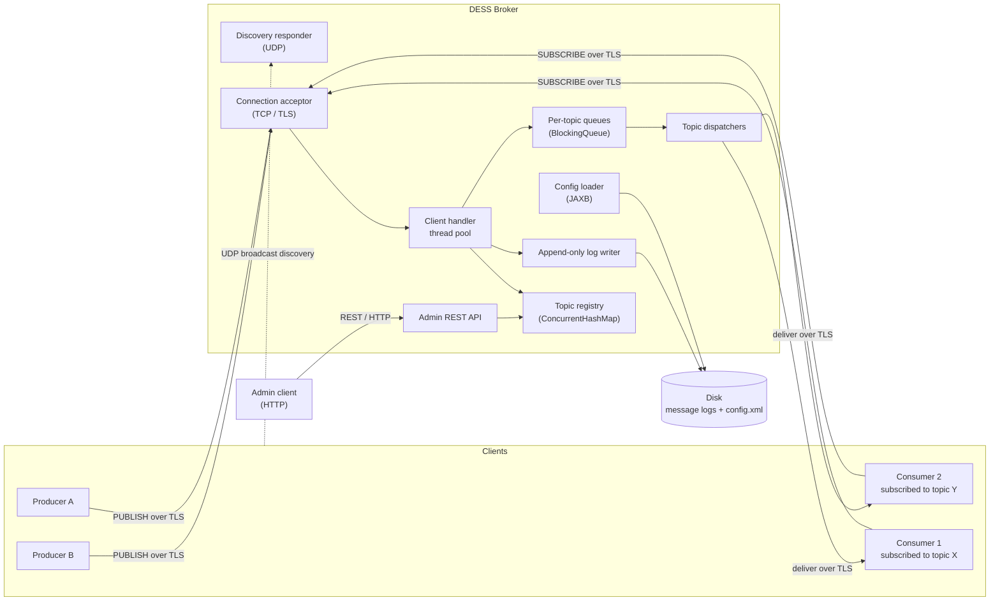
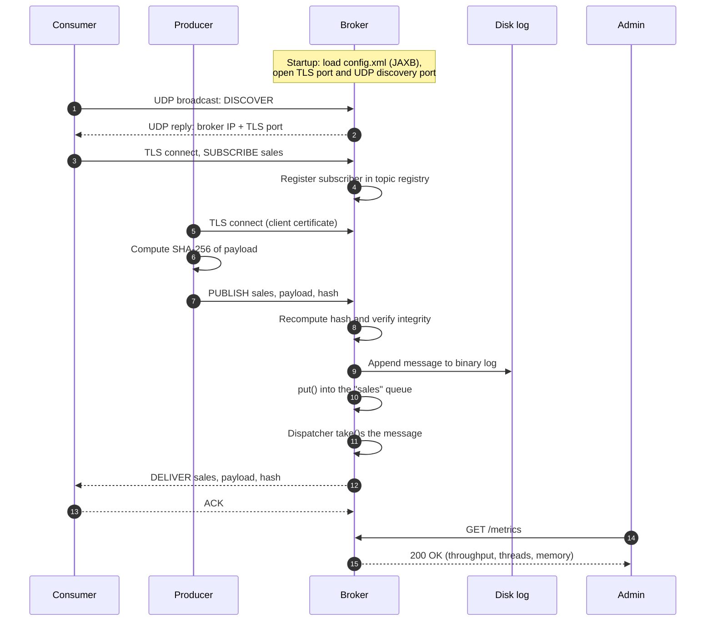

# DESS — Distributed Event Streaming System

[](https://github.com/Dieg0R01/DESS/actions/workflows/ci.yml)

> A publish/subscribe message broker written from scratch in plain Java, built as the practical project for a **Distributed Systems** course in Computer Engineering.

DESS is a small event streaming platform inspired by the architecture of systems like Apache Kafka and RabbitMQ. Producers publish events to named **topics**, a central **broker** buffers, persists and routes those events, and consumers subscribed to a topic receive them in real time. An HTTP **admin API** allows the broker to be inspected and managed from the outside.

The goal is not to compete with production brokers, but to implement by hand — on top of the JDK — the building blocks that a distributed system relies on: networking over TCP and UDP, multithreading and synchronization, durable storage, XML configuration, TLS encryption, message integrity and a web management interface.

> **Status:** design stage. No code has been written yet. This document describes the target architecture.

---

## Table of contents

- [Goals and non-goals](#goals-and-non-goals)
- [Architecture](#architecture)
- [Message lifecycle](#message-lifecycle)
- [Wire protocol](#wire-protocol)
- [Module map](#module-map)
- [Technology stack](#technology-stack)
- [Configuration](#configuration)
- [Admin API](#admin-api)
- [Getting started](#getting-started)

---

## Goals and non-goals

### Goals

- **Reliable, ordered delivery** between producers and consumers over persistent TCP connections.
- **Concurrent broker engine** able to serve many clients at once without one slow client blocking the rest.
- **Decoupled ingestion and delivery** through per-topic in-memory queues (producer–consumer pattern).
- **Durability:** messages survive a broker restart thanks to an append-only log on disk.
- **Zero-configuration discovery:** clients find the broker on the local network via UDP broadcast.
- **Security:** TLS-encrypted channels, certificate-based authentication of producers and SHA-256 integrity checks on every message.
- **Observability and control:** a REST API to list, create and delete topics and to read runtime metrics.

### Non-goals (for now)

- Multi-broker clustering, replication or leader election.
- Topic partitioning and consumer groups.
- Exactly-once delivery semantics.
- Compatibility with the Kafka, AMQP or MQTT wire protocols.

These may be revisited once the core system is complete.

---

## Architecture

The system is made of three kinds of independent processes that communicate over the network, plus an administrative client.



### Components

| Component | Responsibility |
|-----------|----------------|
| **Producer** | Generates events (audit logs, metrics, transactions…) and publishes them to a topic. |
| **Consumer** | Subscribes to one or more topics and processes incoming messages as they arrive. |
| **Broker** | Accepts connections, validates and persists messages, buffers them per topic and fans them out to subscribers. |
| **Admin client** | Uses the broker's REST API to inspect state, manage topics and read metrics. |

### Broker internals

- **Connection acceptor.** A `ServerSocket` (later `SSLServerSocket`) runs `accept()` in a loop and hands every new socket to an `ExecutorService`, so serving one client never blocks the others. `setSoTimeout()` is used to detect clients that disappear silently.
- **Topic registry.** A `ConcurrentHashMap<String, Topic>` holds the topic catalogue and each topic's set of active subscribers, allowing safe concurrent reads and writes.
- **Per-topic queues.** Each topic owns a bounded `BlockingQueue`. Client handler threads `put()` incoming messages; a dedicated dispatcher thread per topic `take()`s them and delivers them to every subscriber, blocking naturally when the queue is empty.
- **Flow control.** A `Semaphore` caps the number of in-flight, not-yet-delivered messages held in memory, applying back-pressure to producers when the broker is saturated.
- **Delivery acknowledgements.** When a message requires confirmation from *N* consumers, the broker waits on a `CountDownLatch(N)` until all ACKs arrive (or a timeout expires).
- **Persistence.** Every accepted message is appended to a binary log through `DataOutputStream` over a `BufferedOutputStream`, so it can be replayed after a restart.
- **Discovery responder.** A `DatagramSocket` listens on a well-known UDP port. Clients broadcast a discovery request and the broker replies with its IP address and TCP port, resolved through `NetworkInterface` / `InetAddress`.
- **Admin API.** A lightweight embedded HTTP server exposes resource-oriented endpoints for management and monitoring.

---

## Message lifecycle

The end-to-end journey of a single message through the complete system:



---

## Wire protocol

Clients and broker talk through a small, versioned protocol over TCP. Every frame carries a command, its fields and, when present, a payload whose length is declared explicitly, so payloads are opaque bytes that never need escaping.

| Command | Direction | Fields | Description |
|---------|-----------|--------|-------------|
| `HELLO` | both | protocol version | Opens every connection; incompatible versions are rejected. |
| `SUBSCRIBE` | client → broker | topic, start position | Register as a subscriber of a topic, from the latest, the earliest or a given offset. |
| `UNSUBSCRIBE` | client → broker | topic | Stop receiving messages from a topic. |
| `PUBLISH` | client → broker | topic, confirmation mode, SHA-256 digest, payload | Publish a message; the digest is verified by the broker. |
| `DELIVER` | broker → client | topic, offset, digest, payload | A message pushed to a subscriber. |
| `ACK` | both | topic, offset | Confirms acceptance (broker → producer) or processing (consumer → broker). |
| `PING` / `PONG` | both | — | Heartbeat that keeps idle connections alive. |
| `ERROR` | broker → client | code, reason | Rejected request, with a stable error code. |

Discovery uses a separate UDP exchange: a client broadcasts a `DISCOVER` datagram and the broker replies with its address, port, protocol version and whether TLS is required. The exact byte layout of each frame is documented together with its implementation.

---

## Module map

DESS is organized as a multi-module build. Each module maps to one part of the system and has a clearly bounded responsibility.

```text
dess/
├── dess-common/        Shared protocol and domain model
├── dess-broker/        The broker server
├── dess-client/        Producer and consumer client library + demo apps
├── dess-admin/         Command-line admin client for the REST API
└── config/             Sample config.xml, keystores and scripts (keytool)
```

| Module | Main packages | Responsibility |
|--------|---------------|----------------|
| `dess-common` | `protocol`, `model`, `security` | Frame encoding/decoding, `Message` and `Topic` value types, SHA-256 hashing utilities. No networking and no threads. |
| `dess-broker` | `net`, `engine`, `storage`, `config`, `discovery`, `admin` | TCP/TLS acceptor and client handlers; topic registry, queues and dispatchers; append-only log; JAXB configuration; UDP discovery responder; embedded REST API. |
| `dess-client` | `producer`, `consumer`, `discovery` | Reusable `Producer` and `Consumer` classes that handle discovery, connection, hashing and ACKs, plus runnable demo applications. |
| `dess-admin` | `cli`, `http` | Admin tool built on `java.net.http.HttpClient` to call the REST API. |

Dependency direction is strictly one-way: `dess-broker`, `dess-client` and `dess-admin` depend on `dess-common`; none of them depend on each other.

### Mapping to course topics

| Course topic | Where it lives |
|--------------|----------------|
| TCP sockets (`Socket`, `ServerSocket`) | `dess-broker/net`, `dess-client` |
| UDP datagrams and broadcast (`DatagramSocket`, `NetworkInterface`) | `dess-broker/discovery`, `dess-client/discovery` |
| Thread pools (`ExecutorService`) | `dess-broker/net` |
| Concurrent collections and blocking queues | `dess-broker/engine` |
| Synchronizers (`CountDownLatch`, `Semaphore`) | `dess-broker/engine` |
| Java I/O streams and file persistence | `dess-broker/storage` |
| XML binding (JAXB) | `dess-broker/config` |
| TLS with JSSE (`SSLSocket`, `keytool`) | `dess-broker/net`, `dess-client`, `config/` |
| Hashing and integrity (SHA-256) | `dess-common/security` |
| REST services and HTTP clients | `dess-broker/admin`, `dess-admin` |

---

## Technology stack

| Concern | Choice |
|---------|--------|
| Language | Java 21 (LTS) |
| Build | Maven (multi-module) |
| Networking | `java.net` (TCP/UDP), `javax.net.ssl` (JSSE) |
| Concurrency | `java.util.concurrent` |
| Persistence | `java.io` binary streams |
| Configuration | Jakarta XML Binding (JAXB) |
| Admin API | Embedded HTTP server (JAX-RS implementation or the JDK `HttpServer`, to be decided) |
| Admin client | `java.net.http.HttpClient` |
| Testing | JUnit 5 |

Frameworks that would hide the distributed-systems mechanics (Spring, Netty, Kafka client libraries, etc.) are intentionally avoided. Note that JAXB has not shipped with the JDK since Java 11, so it is pulled in as an explicit Jakarta dependency.

---

## Configuration

The broker reads its settings from `config.xml` at startup, mapped to Java objects through JAXB (`@XmlRootElement`, `@XmlElement`, `Unmarshaller`). Runtime changes, such as topics created through the API, can be written back with a `Marshaller`.

Tentative shape:

```xml
<broker>
    <network>
        <tcpPort>8443</tcpPort>
        <discoveryPort>9999</discoveryPort>
        <adminPort>8080</adminPort>
        <clientTimeoutMs>30000</clientTimeoutMs>
    </network>
    <engine>
        <queueCapacity>10000</queueCapacity>
        <maxInFlightMessages>50000</maxInFlightMessages>
        <handlerThreads>32</handlerThreads>
    </engine>
    <storage>
        <logDirectory>./data/logs</logDirectory>
    </storage>
    <security>
        <keystore>./config/broker.keystore</keystore>
        <truststore>./config/broker.truststore</truststore>
    </security>
    <topics>
        <topic>sales</topic>
        <topic>sensor-temperature</topic>
    </topics>
</broker>
```

---

## Getting started

> 🚧 **Placeholder.** This section will be filled in as the implementation lands.

### Prerequisites

- JDK 21+
- Maven 3.9+

### Build

```bash
mvn clean verify
```

### Run the broker

```bash
# TODO
java -jar dess-broker/target/dess-broker.jar --config config/config.xml
```

### Run a consumer and a producer

```bash
# TODO
java -jar dess-client/target/dess-client.jar consume --topic sales
java -jar dess-client/target/dess-client.jar produce --topic sales --message "hello"
```

### Generate TLS certificates

```bash
# TODO: keytool scripts under config/
```

### Query the admin API

```bash
# TODO
curl http://localhost:8080/metrics
```

---

## Admin API

The broker exposes a small resource-oriented HTTP API for management and monitoring, bound to the loopback interface by default. The `dess-admin` command-line tool wraps the same operations.

| Method | Path | Description |
|--------|------|-------------|
| `GET` | `/topics` | List topics with their retained messages, subscribers and queue depth. |
| `POST` | `/topics` | Create a topic. Body: `{"name": "sensor-temperature"}`. |
| `DELETE` | `/topics/{name}` | Delete a topic; its subscribers are notified and its log is removed. |
| `GET` | `/metrics` | Message rates, connections, threads, memory, in-flight messages and uptime. |
| `GET` | `/health` | Whether the broker is currently accepting client connections. |

---

## License

To be defined.
