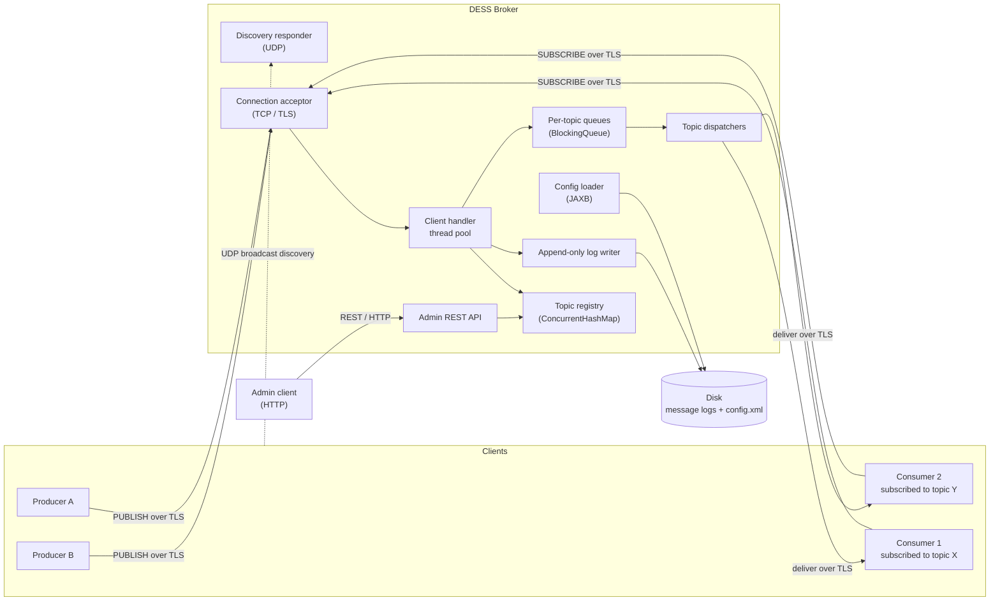
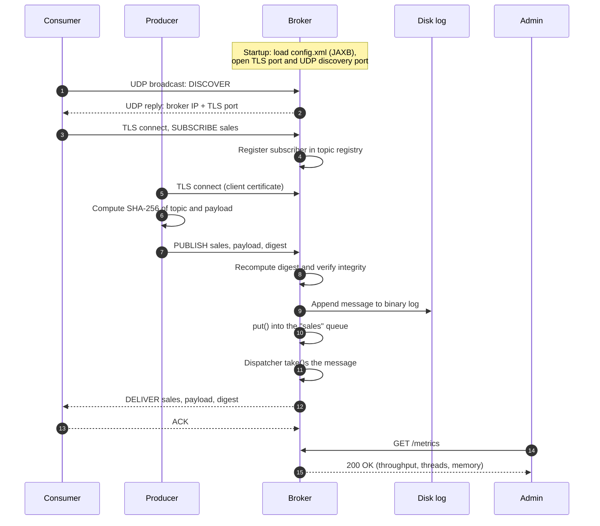

# DESS — Distributed Event Streaming System

[](https://github.com/Dieg0R01/DESS/actions/workflows/ci.yml)

> A publish/subscribe message broker written from scratch in plain Java, built as the practical project for a **Distributed Systems** course in Computer Engineering.

DESS is a small event streaming platform inspired by the architecture of systems like Apache Kafka and RabbitMQ. Producers publish events to named **topics**, a central **broker** buffers, persists and routes those events, and consumers subscribed to a topic receive them in real time. An HTTP **admin API** allows the broker to be inspected and managed from the outside.

The goal is not to compete with production brokers, but to implement by hand — on top of the JDK — the building blocks that a distributed system relies on: networking over TCP and UDP, multithreading and synchronization, durable storage, XML configuration, TLS encryption, message integrity and a web management interface.

> **Status:** protocol version 4 is implemented: a TLS 1.2+ broker with `produce`, `consume` and `bench`. Confirmed messages are in the topic logs. The admin API is served on loopback. After a build and certificates, `./scripts/demo.sh` runs the end-to-end path.

---

## Table of contents

- [Goals and non-goals](#goals-and-non-goals)
- [Architecture](#architecture)
- [Message lifecycle](#message-lifecycle)
- [Wire protocol](#wire-protocol)
- [Module map](#module-map)
- [Technology stack](#technology-stack)
- [Configuration](#configuration)
- [Getting started](#getting-started)
- [Admin API](#admin-api)
- [Performance](#performance)
- [Known limitations](#known-limitations)
- [License](#license)

---

## Goals and non-goals

### Goals

- **Reliable, ordered delivery** between producers and consumers over persistent TCP connections.
- **Concurrent broker engine** able to serve many clients at once without one slow client blocking the rest.
- **Decoupled ingestion and delivery** through per-topic in-memory queues (producer–consumer pattern).
- **Durability:** messages survive a broker restart thanks to an append-only log on disk.
- **Zero-configuration discovery:** clients find the broker on the local network via UDP broadcast.
- **Security:** TLS-encrypted channels, certificate-based authentication of producers and SHA-256 integrity checks on every message.
- **Observability and control:** a REST API to list, create and delete topics and to read runtime metrics.

### Non-goals

- Multi-broker clustering, replication or leader election.
- Topic partitioning and consumer groups.
- Exactly-once delivery semantics.
- Compatibility with the Kafka, AMQP or MQTT wire protocols.

---

## Architecture

The system is made of three kinds of independent processes that communicate over the network, plus an administrative client. The running broker speaks TLS 1.2 or later, answers UDP discovery, writes each confirmed message to its topic log, and serves the admin API on loopback.



### Components

| Component | Responsibility |
|-----------|----------------|
| **Producer** | Generates events (audit logs, metrics, transactions…) and publishes them to a topic. |
| **Consumer** | Subscribes to one or more topics and processes incoming messages as they arrive. |
| **Broker** | Accepts connections, validates and persists messages, buffers them per topic and fans them out to subscribers. |
| **Admin client** | Uses the broker's REST API to inspect state, manage topics and read metrics. |

### Broker internals

- **Connection acceptor.** A `ServerSocket` runs `accept()` in a loop. Each accepted socket is classified and wrapped as an `SSLSocket` on a worker thread, so a slow handshake never blocks `accept()`. `setSoTimeout()` is used to detect clients that disappear silently.
- **Topic registry.** A `ConcurrentHashMap<String, Topic>` holds the topic catalogue and each topic's set of active subscribers, allowing safe concurrent reads and writes.
- **Per-topic queues.** Each topic owns a bounded `BlockingQueue`. Client handler threads `put()` incoming messages; a dedicated dispatcher thread per topic `take()`s them and delivers them to every subscriber, blocking naturally when the queue is empty.
- **Flow control.** A `Semaphore` caps the number of in-flight, not-yet-delivered messages held in memory, applying back-pressure to producers when the broker is saturated.
- **Delivery acknowledgements.** When a message requires confirmation from *N* consumers, the broker waits on a `CountDownLatch(N)` until all ACKs arrive (or a timeout expires).
- **Persistence.** Every confirmed message is appended to that topic's log and forced according to the durability policy, so a later start can replay it.
- **Discovery responder.** A `DatagramSocket` listens on a well-known UDP port. Clients broadcast a discovery request and the broker replies with its IP address and TCP port, resolved through `NetworkInterface` / `InetAddress`.
- **Admin API.** A lightweight embedded HTTP server exposes resource-oriented endpoints for management and monitoring.

---

## Message lifecycle

The end-to-end journey of a single message through the complete system:



---

## Wire protocol

Protocol version 4 is a binary framing inside TLS 1.2 or later. Integers are big-endian and there is no padding. One frame is one record:

```text
uint32 frameLength
uint8  command
uint16 headerLength
byte   header[headerLength]
uint32 payloadLength
byte   payload[payloadLength]
```

`frameLength` counts every byte after itself and equals `7 + headerLength + payloadLength`. The header is at most 1024 bytes and must be exactly the fields its command lists. The payload is at most the configured maximum, 1048576 bytes by default, and is opaque: every byte is kept. A frame longer than 16 MiB + 1031 bytes is rejected.

A topic is a `uint16` length followed by that many UTF-8 bytes. The name matches `[a-z0-9][a-z0-9._-]{0,63}`. An offset is a `uint64`, the per-topic position assigned when the message is accepted, starting at 0 for each topic. A confirmation mode is a `uint8`: `0` is `BROKER` and `1` is `ALL`. A count is a `uint32`. An error header is a `uint16` code length, the ASCII code, a `uint16` reason length and the UTF-8 reason. A header of the wrong shape, an empty client `ACK`, or a mode byte other than 0 or 1 is `MALFORMED_FRAME` and the connection closes.

| Code | Command | Direction | Header | Payload |
|------|---------|-----------|--------|---------|
| 1 | `HELLO` | both | `uint16` version, only version 4 | empty |
| 2 | `PUBLISH` | client → broker | topic, mode, 32-byte digest | message bytes |
| 3 | `SUBSCRIBE` | client → broker | topic, start kind, and a `uint64` offset when the kind is `OFFSET` | empty |
| 4 | `UNSUBSCRIBE` | client → broker | topic | empty |
| 5 | `DELIVER` | broker → client | topic, offset, 32-byte digest | the same message bytes |
| 6 | `ACK` | broker → client | topic, offset, mode, acknowledgement count | empty |
| 6 | `ACK` | client → broker | topic, offset | empty |
| 7 | `PING` | client → broker | empty | empty |
| 8 | `PONG` | broker → client | empty | empty |
| 9 | `ERROR` | broker → client | error code and reason; `ACK_TIMEOUT` also carries topic, offset, expected count and received count | empty |

The TLS handshake finishes before any frame is read. A client that never presents a certificate never reaches `HELLO`. The client's first frame is `HELLO` version 4. The broker answers with `HELLO` version 4. Any other first command is `HANDSHAKE_REQUIRED` and the connection closes. A `HELLO` for any version other than 4, versions 1, 2 and 3 included, is `UNSUPPORTED_VERSION` and the connection closes. A second `HELLO` is `MALFORMED_FRAME`.

The `PUBLISH` digest is `SHA-256` of the topic's length prefix, the topic UTF-8 bytes and the payload. A header that omits those 32 bytes, or that has extra bytes after them, is `MALFORMED_FRAME` and the connection closes. After the topic name is valid and the peer has the producer role, the broker compares the digest with `MessageDigest.isEqual`. A mismatch is `INTEGRITY_FAILED`: the connection stays open and nothing is persisted or delivered. `DELIVER` carries the same 32 bytes that arrived on the matching `PUBLISH`, or, for a version-1 log record, the digest computed from that record's topic and payload. A consumer that sees a mismatch prints `INTEGRITY_FAILED` and does not acknowledge.

A `PUBLISH` from a certificate without the producer role is `UNAUTHORIZED`. The connection stays open and nothing is persisted or delivered. A producer certificate may also subscribe.

`SUBSCRIBE` carries a start kind after the topic. Kind `0` is `LATEST`: the cursor is the topic's next offset when the subscription is registered, and no retained message is delivered. Kind `1` is `EARLIEST`: the cursor is 0, so every retained message is delivered and then messages accepted later, as one offset sequence. Kind `2` is `OFFSET` and is followed by a `uint64` offset. That offset is valid from 0 through the next offset, inclusive. An offset equal to the next offset waits at the live tail and replays nothing. An offset past the next offset is `INVALID_OFFSET`: the connection stays open and no subscription is added. Any other kind, a missing offset, or extra header bytes are `MALFORMED_FRAME` and the connection closes. An unknown topic is resolved before the offset is checked.

`SUBSCRIBE` and `UNSUBSCRIBE` have no reply on success. `UNSUBSCRIBE` of an unknown topic is also silent and does not create the topic. A connection may subscribe to any number of topics. Subscribing twice still delivers one copy. Each subscriber receives `DELIVER` frames for one topic in offset order, each exactly once. A cursor that has left the in-memory tail is read from the topic log; the frame is the same. Frames from different topics on the same connection may interleave; there is no order across topics.

Each accepted `PUBLISH` is answered with one `ACK` or one `ERROR`, never both, and never a reply for a later publish first. In mode `BROKER` the acknowledgement is sent as soon as the message is accepted, with `acknowledgements` 0, whatever the subscribers' pace. In mode `ALL` the broker waits until every subscriber that was registered at acceptance — except the publishing connection — has sent a client `ACK` for that offset. The acknowledgement then carries mode `ALL` and the number of subscribers that did. A subscriber that disconnects during the wait stops counting. With nobody expected, the acknowledgement is immediate and the count is 0. If the wait expires first, the reply is `ACK_TIMEOUT` and the connection stays open.

A consumer acknowledges a delivery with a client `ACK` carrying that topic and offset. Only acknowledgements of `ALL` publishes change a reply. An acknowledgement for a topic the client is not on, or for an offset that client was not delivered, is ignored, logged as a warning, and the connection stays open. A repeated acknowledgement counts once.

The client sends `PING` and the broker answers `PONG`. A command byte outside 1–9 is `UNKNOWN_COMMAND` and the connection stays open.

| Code | When | Connection |
|------|------|------------|
| `MALFORMED_FRAME` | Header of the wrong shape, empty client `ACK`, or unknown mode byte | Closed |
| `UNKNOWN_COMMAND` | Command byte is not 1–9 | Open |
| `UNSUPPORTED_VERSION` | `HELLO` version is not 4 | Closed |
| `HANDSHAKE_REQUIRED` | First frame is not `HELLO` | Closed |
| `PAYLOAD_TOO_LARGE` | Payload exceeds the configured maximum. A frame past the 16 MiB ceiling is also rejected and closes the connection | Open when the payload was read and discarded |
| `INVALID_TOPIC_NAME` | Topic text breaks the naming rule | Open |
| `BROKER_BUSY` | Connection limit reached while accepting | Closed |
| `BROKER_BUSY` | In-flight limit or topic queue still full after the publish wait | Open |
| `UNKNOWN_TOPIC` | Topic does not exist and auto-creation is disabled | Open |
| `SLOW_CONSUMER` | Outbound buffer stayed full beyond the grace period | Closed |
| `ACK_TIMEOUT` | An `ALL` publish was not fully acknowledged in time | Open |
| `STORAGE_UNAVAILABLE` | The record could not be written, or the file could not be forced under `ALWAYS`. Nothing was confirmed and nothing was delivered | Open |
| `INVALID_OFFSET` | `SUBSCRIBE` asked for an offset greater than the topic's next offset | Open |
| `UNAUTHORIZED` | `PUBLISH` from a certificate without the producer role. Nothing is persisted or delivered | Open |
| `INTEGRITY_FAILED` | The digest does not match topic and payload. Nothing is persisted or delivered | Open |
| `TOPIC_DELETED` | An operator deleted the topic this subscription was on | Open |

When the broker-wide in-flight limit is reached, or a topic's queue is full, a publish waits up to the configured publish wait. If room appears, it is accepted. Otherwise the reply is `BROKER_BUSY` and the connection stays open. A message is in flight from acceptance until it has been written to every subscriber that was present then and is still connected. A subscriber whose outbound buffer stays full beyond the grace period receives `SLOW_CONSUMER` and the connection closes.

With auto-creation enabled, the first valid `PUBLISH` or `SUBSCRIBE` on an unknown name creates the topic and writes the name into the configuration file before the command proceeds. With it disabled, both commands receive `UNKNOWN_TOPIC` and the connection stays open. A topic stays in its log and in the configuration file after the broker stops. Offsets on a topic keep increasing across restarts. Under `ALWAYS` the record is forced before any `DELIVER` and before the producer reply. Under `INTERVAL` the record is appended before either, and the force may lag by at most one `syncIntervalMs`.

A client without `--host` finds the broker with a 15-byte UDP request (magic `DESS`, type 1, version 4, nonce) on the configured discovery port, 55124 by default. The broker replies with its TCP port and a flag that TLS is required. `--host` skips discovery. `--port` without `--host` is rejected.

---

## Module map

DESS is organized as a multi-module build. Each module maps to one part of the system and has a clearly bounded responsibility.

```text
dess/
├── dess-common/        Shared protocol and domain model
├── dess-broker/        The broker server
├── dess-client/        Producer, consumer and bench CLIs
├── dess-admin/         Command-line admin client for the REST API
├── config/             Sample config.xml, keystores and scripts (keytool)
└── scripts/            End-to-end demo launcher
```

| Module | Main packages | Responsibility |
|--------|---------------|----------------|
| `dess-common` | `protocol`, `model`, `security`, `json` | Frame encoding/decoding, `Message` and `Topic` value types, SHA-256 hashing utilities, JSON codec for admin bodies. No networking and no threads. |
| `dess-broker` | `net`, `engine`, `storage`, `config`, `discovery`, `admin` | TCP/TLS acceptor and client handlers; topic registry, queues and dispatchers; append-only log; JAXB configuration; UDP discovery responder; loopback HTTP admin API. |
| `dess-client` | `dev.dess.client` | `produce`, `consume` and `bench` over TLS, UDP discovery, SHA-256 publish digests and acknowledgements. `IntegrityProbe` is a demo helper with its own `main`, not a second producer CLI. |
| `dess-admin` | `cli`, `http` | Admin tool built on `java.net.http.HttpClient` to call the REST API. |

Dependency direction is strictly one-way: `dess-broker`, `dess-client` and `dess-admin` depend on `dess-common`; none of them depend on each other.

### Mapping to course topics

| Course topic | Where it lives |
|--------------|----------------|
| TCP sockets (`Socket`, `ServerSocket`) | `dess-broker/net`, `dess-client` |
| UDP datagrams and broadcast (`DatagramSocket`, `NetworkInterface`) | `dess-broker/discovery`, `dess-client/discovery` |
| Thread pools (`ExecutorService`) | `dess-broker/net` |
| Concurrent collections and blocking queues | `dess-broker/engine` |
| Synchronizers (`CountDownLatch`, `Semaphore`) | `dess-broker/engine` |
| Java I/O streams and file persistence | `dess-broker/storage` |
| XML binding (JAXB) | `dess-broker/config` |
| TLS with JSSE (`SSLSocket`, `keytool`) | `dess-broker/net`, `dess-client`, `config/` |
| Hashing and integrity (SHA-256) | `dess-common/security` |
| REST services and HTTP clients | `dess-broker/admin`, `dess-admin` |

---

## Technology stack

| Concern | Choice |
|---------|--------|
| Language | Java 21 (LTS) |
| Build | Maven (multi-module) |
| Networking | `java.net` (TCP/UDP), `javax.net.ssl` (JSSE) |
| Concurrency | `java.util.concurrent` |
| Persistence | `java.nio` file channels, one append-only log per topic |
| Configuration | Jakarta XML Binding (JAXB) and the JDK schema validator |
| Admin API | JDK `HttpServer` (plain HTTP, loopback by default) |
| Admin client | `java.net.http.HttpClient` |
| Testing | JUnit 5 |

Frameworks that would hide the distributed-systems mechanics (Spring, Netty, Kafka client libraries, etc.) are intentionally avoided. Note that JAXB has not shipped with the JDK since Java 11, so it is pulled in as an explicit Jakarta dependency.

---

## Configuration

The broker reads one XML document at startup. The only setting flag is `--config PATH`; when it is omitted, the file is `config.xml` in the working directory. A missing file is an error. The document is checked against a schema and then bound with JAXB. Elements that the document omits take the defaults below. A relative `logDirectory` resolves from the working directory.

A topic created while the broker is running, and a topic found only in a log file at startup, is added to the document. The broker writes the complete document to a temporary sibling, forces it to disk, and moves it over the previous file. A crash during that write leaves the previous complete document.

`durability` `ALWAYS` forces the topic file before the broker confirms the message. `INTERVAL` confirms the message after the append, and a background pass forces every topic file on `syncIntervalMs`. Everything confirmed before the last completed sync survives a kill, and only the newest messages confirmed after it may be lost, within one `syncIntervalMs`. An orderly stop forces every topic file under both policies.

| Setting | Default |
|---------|---------|
| port | 55123 |
| maxConnections | 128 |
| maxPayloadBytes | 1048576 |
| idleTimeoutMs | 30000 |
| maxInFlight | 10000 |
| topicQueueCapacity | 1024 |
| outboundCapacity | 256 |
| slowConsumerGraceMs | 2000 |
| publishWaitMs | 1000 |
| ackTimeoutMs | 5000 |
| threadKeepAliveMs | 1000 |
| shutdownTimeoutMs | 2000 |
| autoCreate | true |
| topics | |
| logDirectory | ./data/logs |
| durability | ALWAYS |
| syncIntervalMs | 1000 |
| level | INFO |
| keyStore | ./config/pki/broker.p12 |
| trustStore | ./config/pki/trust.p12 |
| passwordFile | ./config/pki/password |
| discoveryEnabled | true |
| discoveryPort | 55124 |
| presenceEnabled | false |
| adminBindAddress | 127.0.0.1 |
| adminPort | 55125 |

`config/config.xml` is a complete document:

```xml
<?xml version="1.0" encoding="UTF-8"?>
<broker>
    <network>
        <port>55123</port>
        <maxConnections>128</maxConnections>
        <maxPayloadBytes>1048576</maxPayloadBytes>
        <idleTimeoutMs>30000</idleTimeoutMs>
    </network>
    <engine>
        <maxInFlight>10000</maxInFlight>
        <topicQueueCapacity>1024</topicQueueCapacity>
        <outboundCapacity>256</outboundCapacity>
        <slowConsumerGraceMs>2000</slowConsumerGraceMs>
        <publishWaitMs>1000</publishWaitMs>
        <ackTimeoutMs>5000</ackTimeoutMs>
        <threadKeepAliveMs>1000</threadKeepAliveMs>
        <shutdownTimeoutMs>2000</shutdownTimeoutMs>
    </engine>
    <storage>
        <logDirectory>./data/logs</logDirectory>
        <durability>ALWAYS</durability>
        <syncIntervalMs>1000</syncIntervalMs>
    </storage>
    <topics autoCreate="true">
        <topic>sales</topic>
    </topics>
    <logging>
        <level>INFO</level>
    </logging>
    <security>
        <keyStore>./config/pki/broker.p12</keyStore>
        <trustStore>./config/pki/trust.p12</trustStore>
        <passwordFile>./config/pki/password</passwordFile>
    </security>
    <discovery enabled="true" presence="false">
        <port>55124</port>
    </discovery>
    <admin>
        <bindAddress>127.0.0.1</bindAddress>
        <port>55125</port>
    </admin>
</broker>
```

---

## Getting started

### Prerequisites

- JDK 21+
- Maven 3.9+

### Build

```bash
mvn clean verify
```

`mvn package` also leaves the shaded jars under each module's `target/` directory. `verify` runs the tests as well.

### Generate development certificates

```bash
config/generate-certs.sh
```

The script writes `password`, `ca.p12`, `trust.p12`, `broker.p12`, `producer.p12` and `consumer.p12` under `config/pki`. A second run prints `kept` for each file and leaves the bytes unchanged. `--force` rewrites the six base files. `--client NAME --role producer|consumer` adds another identity signed by the same CA. The directory is listed in `.gitignore`.

### Run the broker

```bash
java -jar dess-broker/target/dess-broker.jar --config config/config.xml
```

```text
Usage: dess-broker [--config PATH]
```

`--config` selects the document described above. The default path is `config.xml` in the working directory. `--help` and `-h` print the name, version and usage, then exit 0. An unknown flag, a missing value, or `--config` given twice prints the usage line to standard error and exits 2. A missing file, an invalid document, a missing or unusable key store, trust store or password file, a discovery port or admin port that cannot be bound, a log directory that cannot be created or is already in use, or a log damaged in the middle exits 1 and prints the problem without the usage line. An admin bind failure prints `Could not bind admin port` and the port number. The sample file declares `sales` and stores the topic logs in `./data/logs`. The admin API listens on `127.0.0.1:55125` unless `<admin>` says otherwise.

```bash
curl -sS http://127.0.0.1:55125/health
java -jar dess-admin/target/dess-admin.jar health
```

Either command prints `{"status":"UP"}` or `STATUS UP` while the broker is accepting clients.

### Run a consumer and a producer

```bash
java -jar dess-client/target/dess-client.jar consume --topic sales --from earliest
java -jar dess-client/target/dess-client.jar consume --topic sales --resume
java -jar dess-client/target/dess-client.jar produce --topic sales --message hello --identity config/pki/producer.p12
```

```text
Usage: dess-client produce|consume|bench --topic NAME [--topic NAME] [--message TEXT] [--confirm BROKER|ALL] [--from latest|earliest|OFFSET] [--resume] [--resume-file PATH] [--payload-bytes N] [--producers N] [--consumers N] [--messages N] [--host HOST] [--port N] [--discovery-port N] [--presence-ms N] [--identity PATH] [--trust-store PATH] [--password-file PATH] [--heartbeat-ms N] [--log-level LEVEL]
```

`consume` may repeat `--topic`. `produce` and `bench` take one `--topic`. With `--message`, the producer publishes that UTF-8 text and exits 0 after the acknowledgement. Without `--message`, each line from standard input is one payload. `--confirm` is accepted only by `produce` and applies to every publish: `BROKER` (the default) or `ALL`. Any other value exits 2. The consumer prints the topic, one space, the payload and a newline, then acknowledges that delivery with the topic and offset.

`--from` is `consume` only. `latest` starts at the next offset, `earliest` replays from offset 0, and `OFFSET` is a decimal integer from 0 up. The default is `latest`. `--resume` is `consume` only: each topic starts at its stored offset plus one, or at `latest` when the offset file has no line for it. After printing a delivery the client rewrites that file, forcing a temporary sibling and moving it into place, and only then sends the acknowledgement. `--resume-file` defaults to `dess-offsets` in the working directory and, by itself, neither reads nor writes. `--resume` together with `--from` exits 2. `produce` rejects `--from`, `--resume` and `--resume-file` with exit 2. `consume` without `--from` and without `--resume` subscribes at `latest` and does not write an offset file.

An error from the broker, including `UNKNOWN_TOPIC`, `BROKER_BUSY`, `ACK_TIMEOUT`, `SLOW_CONSUMER`, `STORAGE_UNAVAILABLE`, `INVALID_OFFSET`, `UNAUTHORIZED`, `INTEGRITY_FAILED` and `TOPIC_DELETED`, prints one line containing the code and exits 1. `TOPIC_DELETED` is fatal only when no subscription remains; otherwise the consumer drops that topic and continues. An `ACK_TIMEOUT` line also contains the expected and received counts. The broker leaves the connection open for `STORAGE_UNAVAILABLE`, `INVALID_OFFSET`, `UNAUTHORIZED`, `INTEGRITY_FAILED` and `TOPIC_DELETED`. A `DELIVER` whose digest does not match prints `INTEGRITY_FAILED` with the topic and offset, does not print the payload, and exits 1.

Without `--host` the client discovers the broker on UDP port 55124. `--host` skips discovery and `--port` then defaults to 55123. `--port` without `--host` exits 2. `--identity` defaults to `./config/pki/producer.p12` for `produce` and `bench`, and to `./config/pki/consumer.p12` for `consume`. `--trust-store` defaults to `./config/pki/trust.p12` and `--password-file` to `./config/pki/password`. A handshake failure prints one line naming `EXPIRED`, `UNTRUSTED`, `NOT_BROKER` or `PROTOCOL_VERSION` and exits 1. `--presence-ms N` announces the certificate `CN` every N milliseconds when the broker has presence enabled.

### Measure throughput

`bench` is a `dess-client` command. It opens N producer sessions and M consumer sessions in one JVM, publishes `--messages` payloads per producer (default payload 1024 bytes), waits for every unique delivery, and prints a KEY VALUE report. Confirmation is `BROKER`. Consumers subscribe from `earliest`. Producer sessions use `--identity` (default `producer.p12`); consumer sessions use `consumer.p12` next to that identity.

```bash
java -jar dess-client/target/dess-client.jar bench --topic bench --payload-bytes 1024 --producers 1 --consumers 1 --messages 10000
```

`--payload-bytes`, `--producers` and `--consumers` default to 1024, 1 and 1. Each must be at least 1. `--messages` is required. `--host`, `--port` and `--discovery-port` follow `produce`: `--port` without `--host` exits 2. Unknown flags or a missing `--topic` exit 2 with the usage line. A refused connect or a broker `ERROR` exits 1.

Stdout after shutdown looks like:

```text
payloadBytes 1024
producers 1
consumers 1
messages 10000
messagesPerSecond 1842.5
latencyP50Ms 1.2
latencyP99Ms 8.4
os Mac OS X 15.6 aarch64
processors 10
maxMemoryBytes 4294967296
```

`messagesPerSecond` is producers × messages divided by wall seconds, counted from unique deliveries. Latency is publish to the first matching `DELIVER`, in milliseconds. If the OS load average is greater than the processor count, a final line `loadWarning true` is added.

### Query the admin API

Plain HTTP on the configured bind, `127.0.0.1:55125` by default. There is no TLS and no authentication on this socket.

```bash
curl -sS http://127.0.0.1:55125/health
curl -sS http://127.0.0.1:55125/topics
curl -sS http://127.0.0.1:55125/metrics
java -jar dess-admin/target/dess-admin.jar topics list
java -jar dess-admin/target/dess-admin.jar --json topics create demo
java -jar dess-admin/target/dess-admin.jar topics delete demo
java -jar dess-admin/target/dess-admin.jar metrics
java -jar dess-admin/target/dess-admin.jar health
```

```text
Usage: dess-admin [--url URL] [--json] [--log-level LEVEL] topics list|create NAME|delete NAME|metrics|health
```

`--url` is the origin only and defaults to `http://127.0.0.1:55125`. `--json` prints the response body. Without it, stdout is a table. HTTP 2xx exits 0. HTTP 400 or higher, a connect failure, or a body that is not the documented JSON exits 1 and prints the status (or `UNREACHABLE`) plus the error `message` when the body has that shape. Unknown commands, a missing name, or `--url` without a value exit 2. `--help` and `-h` print the name, version and usage, then exit 0.

### Run the demo

After `mvn clean verify` or `mvn package`, and after `config/generate-certs.sh`:

```bash
mvn clean verify
config/generate-certs.sh
./scripts/demo.sh
```

`DEMO_CONFIG=path/to.xml ./scripts/demo.sh` overrides `config/config.xml`. The script copies that document into a work directory so the sample file is left unchanged.

The launcher starts `dess-broker`, two `consume` clients (`--from earliest` and `--resume`), two `produce` invocations, then `java -cp dess-client/target/dess-client.jar dev.dess.client.IntegrityProbe --topic demo`. That helper is not a second producer CLI: `java -jar dess-client.jar` still launches `produce`, `consume` or `bench`. The probe publishes one payload whose digest is 32 zero bytes so the broker answers `INTEGRITY_FAILED` and the process exits 0. The script then calls `dess-admin health` and `metrics` on the bound admin port, sends SIGTERM to the broker from this parent process, starts it again on the same config and log directory, observes recovery, produces one more payload, and stops every child.

Exit 0 means every step succeeded and no child is still running. A failed step prints its name and exits 1. Missing jars or PKI exit 2. If the broker cannot bind its TCP, discovery or admin port, the script reprints `Could not bind port`, `Could not bind admin port` or `Could not bind discovery port` and `Change the matching element in config/config.xml`.

---

## Admin API

The broker serves a small resource-oriented HTTP API on the configured bind address and port. The default configuration is loopback only (`127.0.0.1:55125`). JSON bodies are UTF-8. Successful JSON responses use `Content-Type: application/json; charset=UTF-8`. While the broker is starting or stopping, every path returns `503` with `{"status":"UNAVAILABLE"}`. The `dess-admin` command-line tool calls the same endpoints.

### `GET /topics`

Lists every live topic, lexicographic by name. `topics` is present even when empty.

```bash
curl -sS http://127.0.0.1:55125/topics
```

```json
{
  "topics": [
    {
      "name": "sales",
      "retainedCount": 12,
      "subscriberCount": 2,
      "queueDepth": 3
    }
  ]
}
```

### `POST /topics`

Creates a topic through the same catalogue as client traffic. The body is a JSON object whose only required member is `name`. Extra members are ignored. A body larger than 4096 bytes is `400`.

```bash
curl -sS -D - -H 'Content-Type: application/json' \
  -d '{"name":"sensor-temperature"}' http://127.0.0.1:55125/topics
```

`201` includes `Location: /topics/sensor-temperature`:

```json
{
  "name": "sensor-temperature",
  "retainedCount": 0,
  "subscriberCount": 0,
  "queueDepth": 0
}
```

An invalid name is `400` and the message quotes `[a-z0-9][a-z0-9._-]{0,63}`. Malformed JSON or a missing `name` is `400`. A name that already exists is `409`.

### `DELETE /topics/{name}`

Removes the topic, notifies subscribers with `ERROR TOPIC_DELETED` (the reason is the topic name), deletes `{name}.log` and drops the name from the configuration document. The client connection stays open.

```bash
curl -sS -D - -X DELETE http://127.0.0.1:55125/topics/ops
```

`204` has an empty body. An invalid `{name}` is `400`. A valid name that is not in the catalogue is `404`.

### `GET /metrics`

Rates are averages over the last 10 seconds. `heapMaxBytes` is JSON `null` when the JVM reports no heap maximum.

```bash
curl -sS http://127.0.0.1:55125/metrics
```

```json
{
  "takenAt": "2026-10-11T18:00:00Z",
  "messagesInPerSecond": 1000.0,
  "messagesOutPerSecond": 980.0,
  "activeConnections": 4,
  "activeThreads": 12,
  "heapUsedBytes": 12345678,
  "heapMaxBytes": 268435456,
  "inFlight": 7,
  "uptimeSeconds": 42,
  "topics": [
    {"name": "sales", "queueDepth": 3}
  ]
}
```

### `GET /health`

```bash
curl -sS http://127.0.0.1:55125/health
```

| Health | Status | Body |
|--------|--------|------|
| Accepting clients | `200` | `{"status":"UP"}` |
| Starting or stopping | `503` | `{"status":"UNAVAILABLE"}` |

### Errors

Unless a row above says the body is empty, an error body is:

```json
{
  "error": "INVALID_TOPIC_NAME",
  "message": "Topic names match [a-z0-9][a-z0-9._-]{0,63}"
}
```

`error` is a short machine token (`INVALID_TOPIC_NAME`, `TOPIC_EXISTS`, `UNKNOWN_TOPIC`, `MALFORMED_BODY`, `METHOD_NOT_ALLOWED`, `NOT_FOUND`, `UNAVAILABLE`). `message` is human-readable and never empty.

A known path with the wrong method is `405` and `Allow` lists the methods that path accepts (`GET, POST` on `/topics`, `DELETE` on `/topics/{name}`, `GET` on `/metrics` and `/health`). An unknown path is `404` with `NOT_FOUND`. Every finished request logs `admin.request` with `method`, `path`, `status` and `durationMs`.

---

## Performance

`dess-client bench` records these rows: 1 KiB payloads, TLS, durability `ALWAYS`, loopback, consumer count equal to producer count, 1000 messages per producer. Throughput is unique deliveries (producers × messages) per wall second. Latency is publish to the first matching `DELIVER`. Each cell is the median of three runs; those three throughputs stayed within ±15%. Hardware is `Mac OS X 26.6.2 aarch64`, 10 processors, `maxMemoryBytes` 4294967296 (4 GiB).

| Producers | Consumers | Payload | Durability | Transport | messages/s | p50 (ms) | p99 (ms) |
|-----------|-----------|---------|------------|-----------|------------|----------|----------|
| 1 | 1 | 1 KiB | ALWAYS | TLS, loopback | 252 | 4.0 | 5.4 |
| 4 | 4 | 1 KiB | ALWAYS | TLS, loopback | 259 | 15.1 | 19.1 |
| 16 | 16 | 1 KiB | ALWAYS | TLS, loopback | 254 | 63.4 | 69.0 |

The documented goal is 5,000 messages/s. These runs measured about 250 messages/s, about twenty times below that goal. Throughput stayed flat from 1 to 16 producers because each acknowledgement waits for an `ALWAYS` fsync on a single broker over TLS. Latency grows with producer count as those forced writes queue. A `loadWarning true` line is printed when the one-minute OS load average exceeds the processor count.

---

## Known limitations

- One broker process: no replication and no leader election.
- Topics are not partitioned and consumers do not form groups.
- A lost producer `ACK` is retried as at-least-once; the broker does not offer exactly-once produce.
- Topic logs grow without retention or compaction.
- There is no certificate revocation list.
- The wire protocol is DESS version 4. It is not Kafka, AMQP or MQTT.
- There is no web dashboard and no SOAP admin API.

---

## License

DESS is course work for a Distributed Systems class. The repository is published so students and evaluators can read and run the code. That is not a license grant for production use, and no SPDX identifier is attached.
